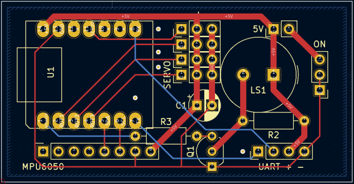
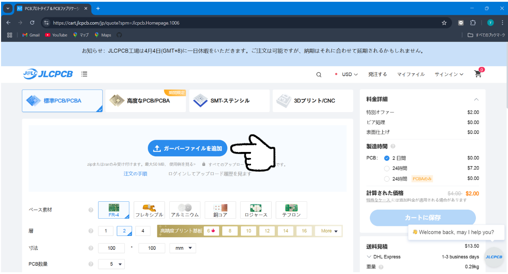
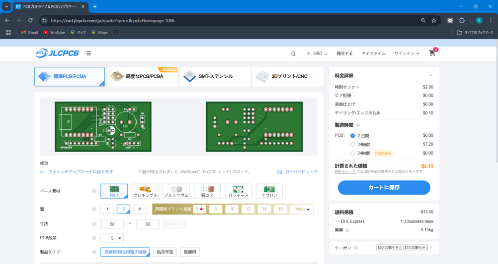
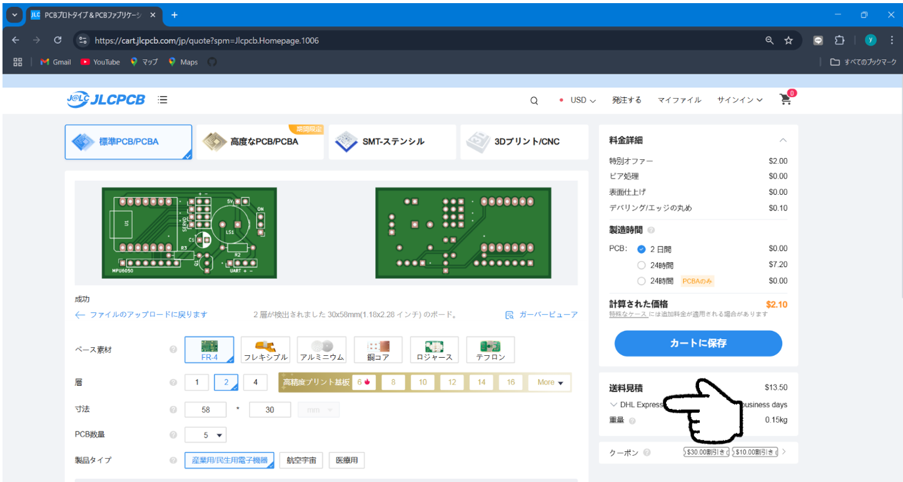
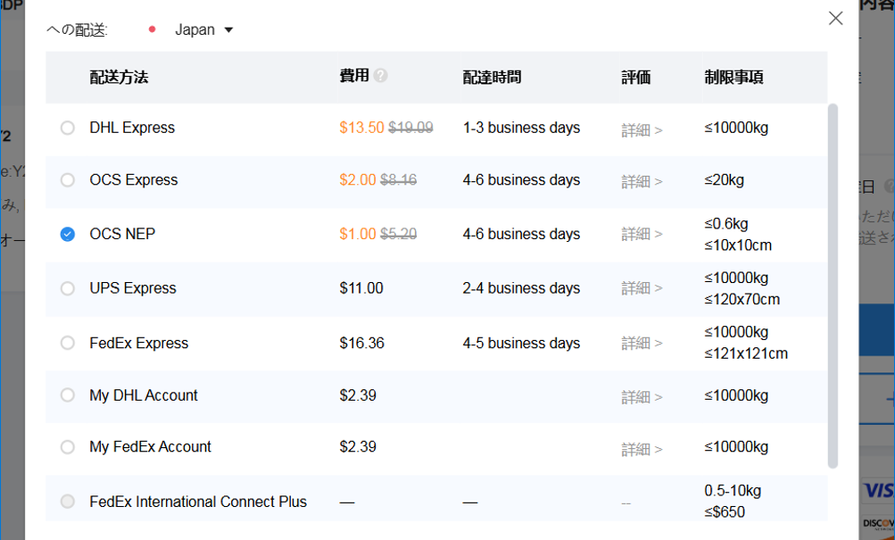
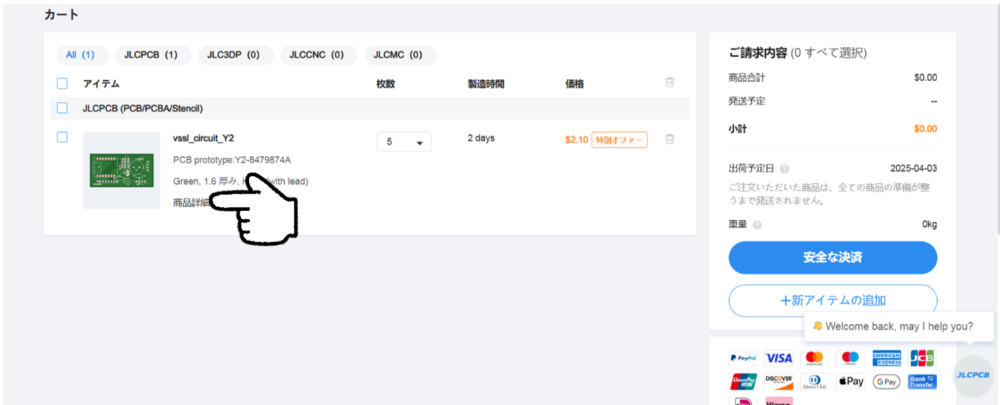
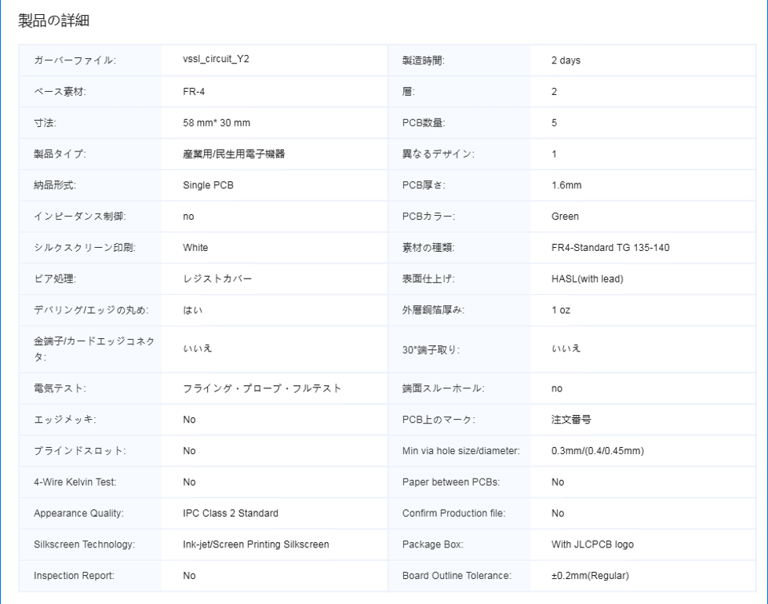

# 基板の発注
　安価に調達するため，JLCPCB（あるいはELECROW）で発注することを薦める。ただし，本サイトは中国なので購入に手間がかかるかもしれない。

プリント基板のパターン

## 1. JLCPCBの発注ページへ
　まず、 [JLCPCBのトップページ](https://jlcpcb.com/jp)にアクセスする。
　右上の発注ボタンをクリック。

## 2. ガーバーファイルのアップロード
　 

「ガーバーファイルを追加」ボタンをクリックし、発注する基板のガーバーファイルをアップロードする。ガーバーファイルはグーグルドライブのgerberフォルダのvssl_circuit.zip。zipファイルをそのままアップロードする。

## 3. オプションの確認
　「標準PCB/PCBA」を選択する。

　画面下の方にあるオプションは、デフォルトのままでよい。基板の色は、何にしても良いが、黄色はシルクが読みにくいのでおすすめしない。

## 4. 配送方法の選択
①　「送料見積」の下をクリックし、配送方法の選択へ進む。

 
②　配送方法を選択する。一番安かった「OCS NEP」でも問題なく届いた。 

## 5. 商品詳細の確認
①「カートに保存」ボタンをクリックしてから、かごの中身を確認する。

②「商品詳細」をクリックして出てくる画面を確認する。 

## 6. 決済
　クレジットカードの番号を入力するのが不安な場合は、PayPalなども使用できる。
 