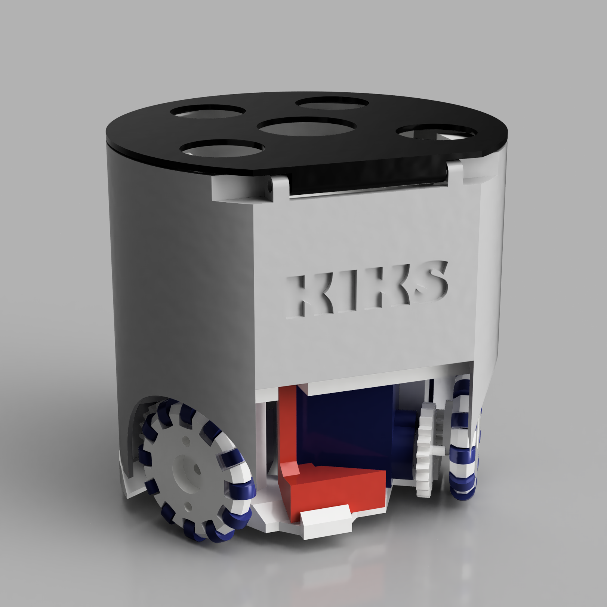

CADデータ:  [fusion360のプロジェクト](https://a360.co/3XhVYXd)

設計に関するデータは
[グーグルドライブ](https://drive.google.com/drive/folders/1fOG-YyxghJurZSG6twQviDu5QsxXvmG_?usp=drive_link)
にまとめてあります。

https://drive.google.com/drive/folders/1fOG-YyxghJurZSG6twQviDu5QsxXvmG_?usp=drive_link

**グーグルドライブのフォルダ：**

| フォルダ名 | 内容 |
| ---- | ---- |
| fusion | fusion360のファイル |
| gerberフォルダ | 基板発注用ガーバーファイル |
| kicad | kicadのプロジェクトフォルダ |
| parts-list | 部品リスト |
| stl | stlファイル（3Dプリンタ用）|
| stl_easy | 組み立てを簡易化したバージョンのstlファイル|
