ほとんどの部品は秋月電子通商とAmazonで購入できる。以下部品リスト：

## 秋月電子で購入可能なもの

| 部品 | 型番など | 数量 | 単価（円） | 備考 | 写真 |
|---|---|---:|---:|---|:---:|
| 電池ボックス 単4×4本 | BH-441A150 | 1 | 80 | 電池のサイズを間違えないように | 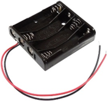 |
| マイコン Seeed Studio XIAO ESP32C3 | 113991054 | 1 | 1080 |  | 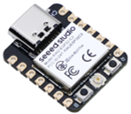 |
| 連続回転サーボモーター | FS90R | 3 | 500 | Amazonでも買える | 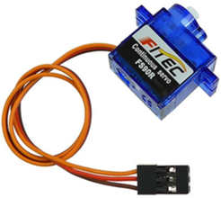 |
| サーボモーター | SG-90 | 1 | 600 | Amazonでも買える | 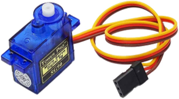 |
| 圧電スピーカー | 104118 | 1 | 30 |  | 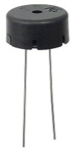 |
| 電解コンデンサ（100 μF） | 35ZLH100MEFC6.3X11 | 1 | 15 | 容量は多少違っても問題ない | 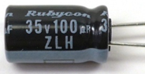 |
| 抵抗（1 kΩ）100本入 | CF25J1KB | 2 | 1 | 100本入り100円 | 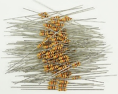 |
| トランジスタ（2SC1815） | 2SC1815 | 1 | 5 | 20個入り100円 | 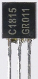 |
| スライドスイッチ | SS-12D00G3 | 1 | 20 | 電源スイッチ | 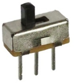 |
| ピンヘッダ | PH-1x40SG | 30ピン | 35 | 長く連なっている40Pものを割って使う | 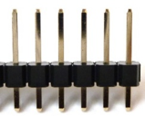 |
| ピンソケット | FHU-1x42SG | 8ピン | 80 | 分割ロングピンソケット42Pを割って使う | K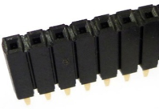 |
| コネクター用ハウジング 2P | 2226A-02 | 1 | 10 | 電池ボックスにコネクターを付けるために使用。圧着工具が必要。器用な人はペンチでも可 | 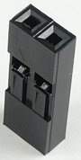 |
| ケーブル用コネクター | 2226TG | 2(?) | 5 | 10個入り50円。電池ボックスのコネクターに使うだけなら2つ。モーターのケーブルを短く作り直すなら＋12個必要 | 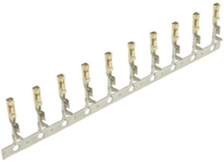 |

## その他（Amazonや百均などで購入可能なもの）

| 部品 | 型番など | 数量 | 単価（円） | 備考 | 写真 |
|---|---|---:|---:|---|:---:|
| 6軸IMUモジュール | MPU6050 | 1 |  | 同様のモジュールはたくさんあるが、MPU6050を使用しているものならほぼOK | N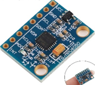 |
| M2ねじ | 長さ6mm、8mm、12mm | 各100 | 1200 | いろんな長さのねじがセットになっているものがよい |  |
| 3Dプリンタフィラメント（黒） | PLA 1kg | 1 |  | ロボットカバー用 |  |
| 3Dプリンタフィラメント（黒または白） | PETG 500g | 1 |  | キックバー用 |  |
| アルミ線 | φ1mm × 2m |  |  | ホイール小リング固定用 |  |
| 単4充電池 |  | 4 |  | 価格にばらつきがある。BONAI（中国製）8本で約千円のもので動作確認済み |  |