# 制御用回路の実装
## 1. マイコンへのピンヘッダの取り付け
ピンヘッダをマイコンに差し込み，はんだ付けする。斜めにならないように注意。

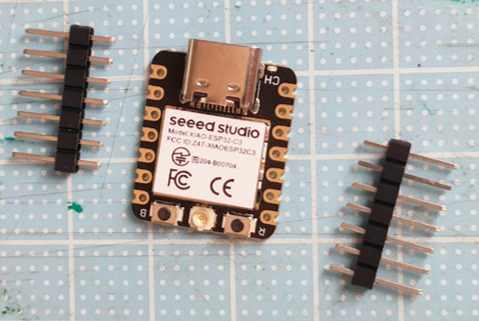 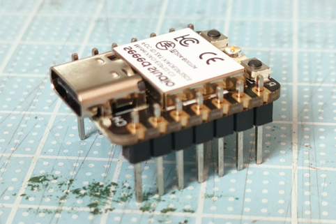

## 2. IMUへのピンヘッダの取り付け
ピンヘッダをIMUに差し込み，斜めにならないように注意してはんだ付けする。はんだ付けする面に注意。
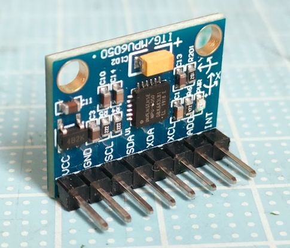

## 3. 基板への部品実装
基板の表側から部品の足を差し込み，裏面をはんだ付けする。背の低い部品（抵抗，圧電スピーカなど）から実装するのが基本。
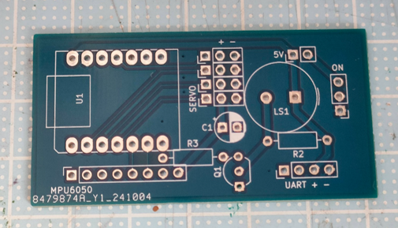 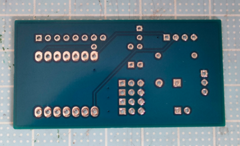

基板の表（左図）と裏（右図）

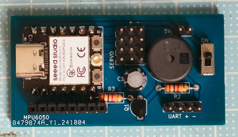 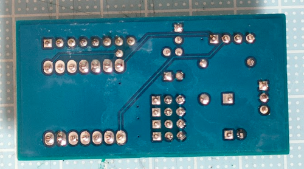

部品実装後の基板の表（左図）と裏（右図）

## 4. マイコンへのアンテナの取り付け
マイコン付属のアンテナを取り付ける。位置を合わせて押し込むと固定される。アンテナで隣のスイッチを押してしまわないように注意。

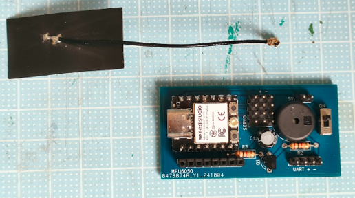 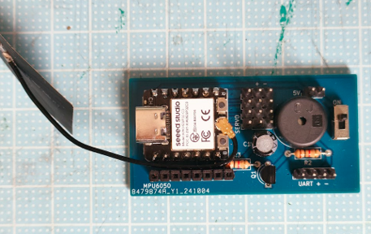

マイコンとアンテナ（左図）および　取り付けた状態（右図）

## 5. IMUの接続
ピンソケットに差し込むだけ。

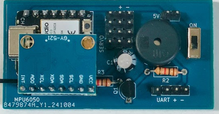
 
IMUを接続した基板

## 6. 電池ボックスへのコネクターの取り付け
電池ボックスの配線を6 cmぐらいになるように切って，コネクターを付ける。圧着工具の使用が確実であるが，ペンチでもできないことはない。
   
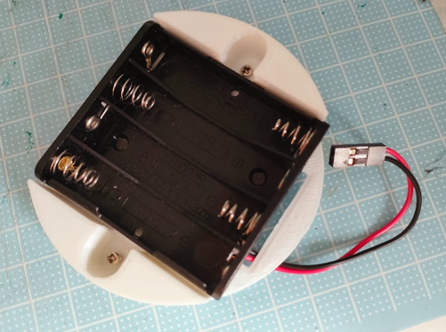

ピンソケットをはんだ付けする方法でもよいが，熱縮チューブなどで絶縁すること。：

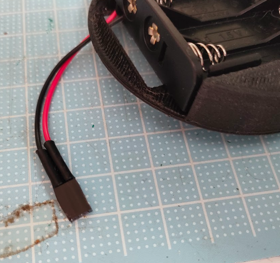
