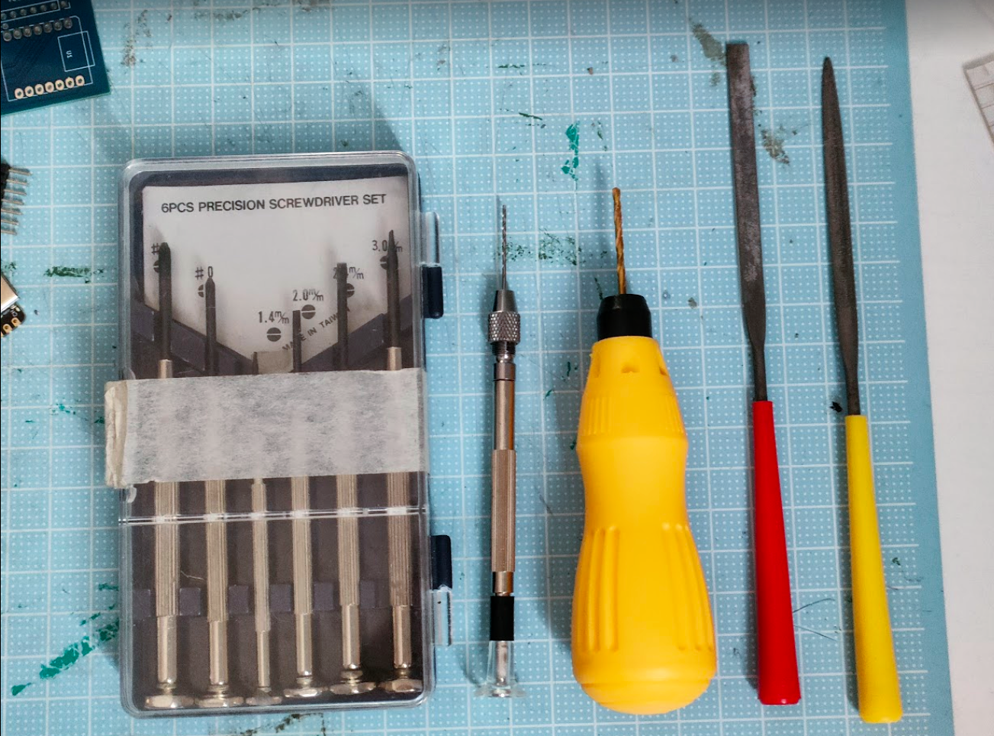

# 使用する工具

- 精密ドライバー
    
    M2のねじを締められるもの。

- ドリル（1mm，2mm）
    
    3Dプリントした部品の穴を開け直すのに使用。
    
    3Dプリントが高精度できれいにできるなら不要かも。

- やすり，ニッパー
    
    3Dプリントした部品を整形するのに使用。

- はんだごて
    
    制御用回路基板を実装するのに使用。

**刃物の取り扱いには注意。**