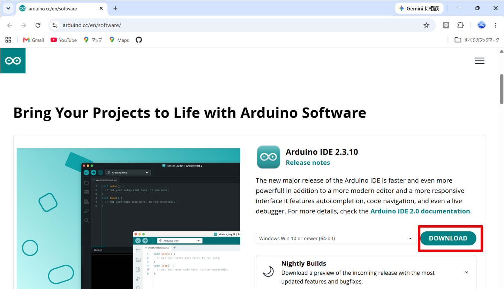
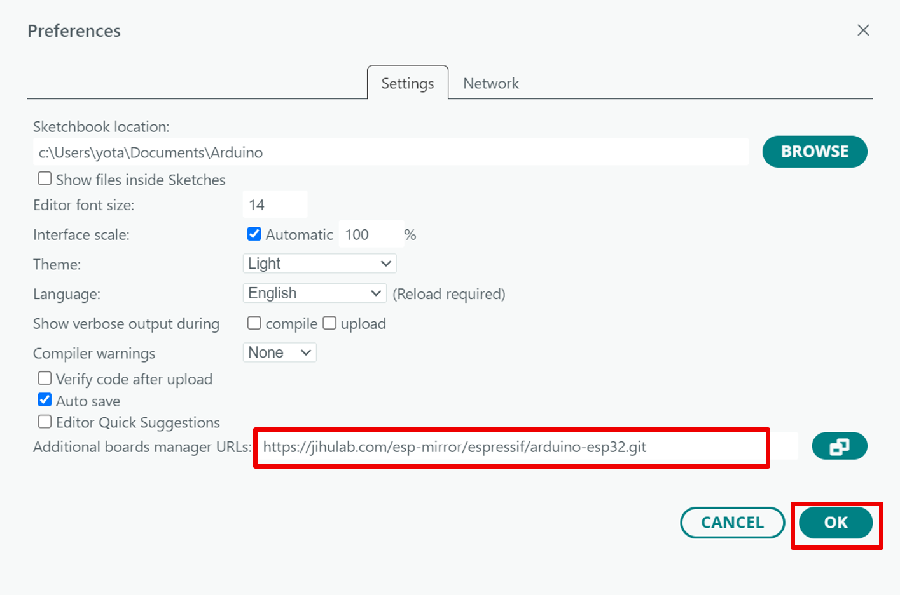
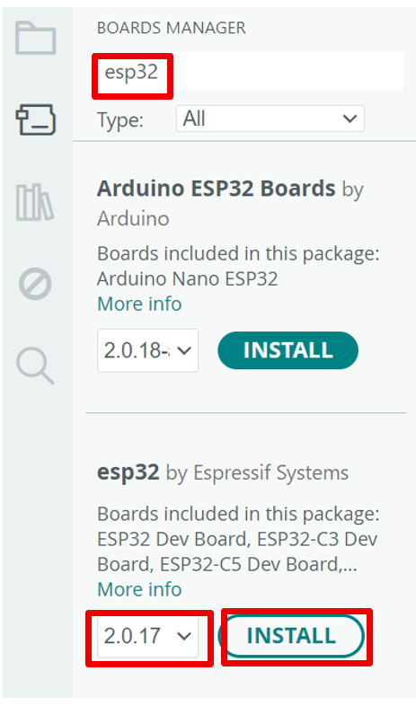
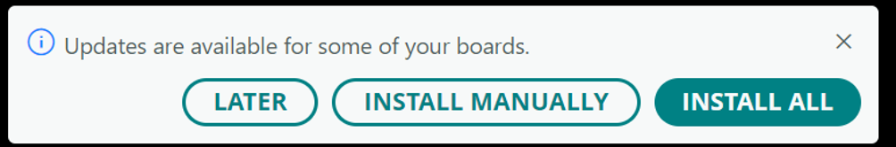
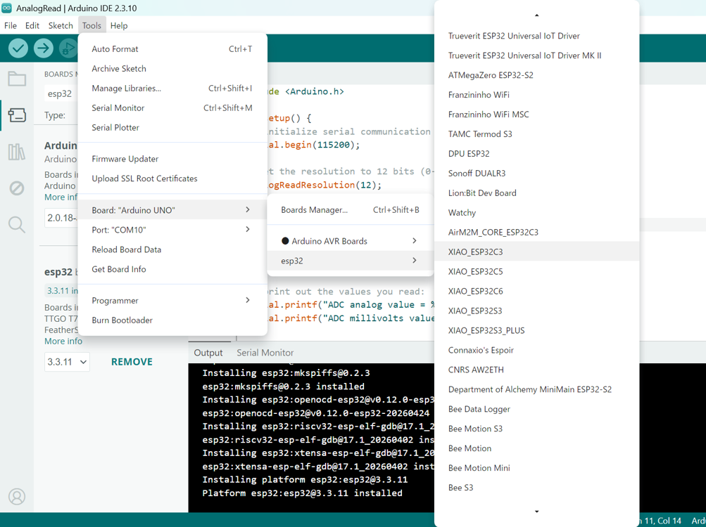
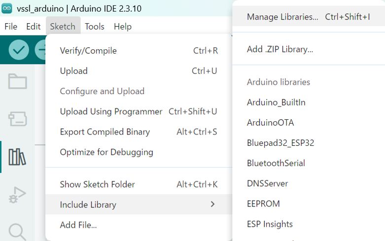
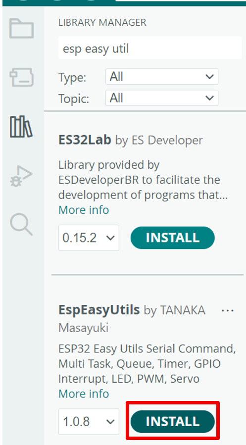
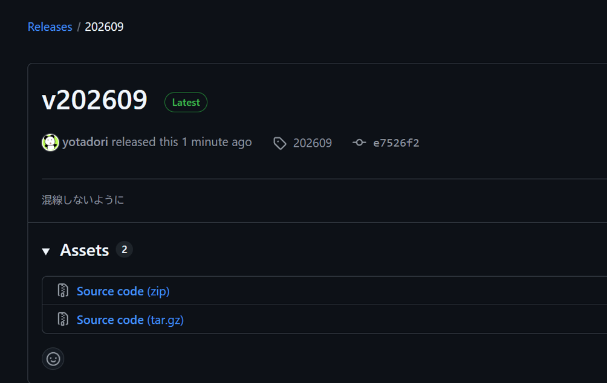
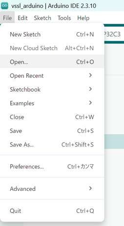

# 環境構築

Seeed Studioの公式Wiki（https://wiki.seeedstudio.com/ja/XIAO_ESP32C3_Getting_Started）の「ソフトウェアの準備」とおりに進めれば大丈夫です。

## 1. Arduino IDE のインストール

1. ブラウザで検索するか，下記のURLからダウンロードページへ行く：

> https://www.arduino.cc/en/software/

Arduino IDE ダウンロードページ

2. 「DOWNLOAD」ボタンを押すと，ダウンロードが始まる。

3. ダウンロードした実行ファイルを実行し，セットアップウィザードに沿って進めると，インストールが完了する。

## 2. Arduino IDE を起動

インストールしたArduino IDEを起動します

## 3. Arduino IDEにESP32ボードパッケージを追加

1. File \> Preferencesに移動し、「Additional boards manager
URLs」に以下のURLを入力します：

> <https://jihulab.com/esp-mirror/espressif/arduino-esp32.git>

2. OKを押します。

3. Tools \> Board \> Boards Manager...
に移動し、検索ボックスにキーワード「esp32」を入力し、esp32の**バージョン2.0.17**を選択し、インストールします。

　※バージョン3.0以上を選ぶと大きく変わってしまうので、気を付けてください

　※次回起動時に新しいバージョンに更新するよう提案されますが無視すればよいです：

## 4. ボードを選択する

Tools \> Board \> esp32
に移動し、「XIAO_ESP32C3」を選択します。

## 5. ライブラリのインストール

Sketch \> Include Library \> Manage Libraries
から、ライブラリマネージャーを開き、EspEasyUtilsをインストールします

## 6. プログラムのダウンロード

1. 下記URLを開く。

> <https://github.com/yotadori/vssl-arduino/releases/tag/v202609>

2. Source code (zip) をダウンロードし，解凍します。

3. Arduino IDEでプログラムを開く

File \> Open
から、ダウンロードしたフォルダ内のvssl_arduino.inoを開きます。

