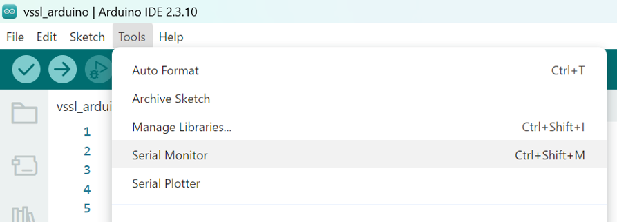
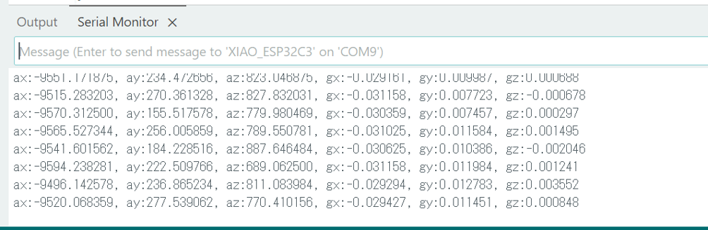

# IMUを使おう

プログラム
8を実行後，ロボットをまっすぐに走らせたいと思っても曲がってしまうことがあります。これは床面とタイヤのスリップ，ギヤ間のバックラッシュなどの要素が関係しています。これを解決するために，ロボットに搭載されている6軸IMUを用います。IMUはInertial
Measurement
Unit（慣性計測ユニット）の略で，3次元空間における物体の慣性運動（直交3軸方向の並進運動と回転運動）を検出するデバイスです。並進運動を加速度センサ，回転運動をジャイロセンサで検出することで，物体の運動や姿勢の制御に利用できます。自動運転（ロボットやモビリティの姿勢制御）や位置推定，振動や向きの検知など，モーションコントロールには欠かせないデバイスです。

## 1. IMUの値を見てみる

以下はIMUの値をシリアルモニタで見るプログラムです。

-   プログラム 9　IMUの値をシリアル出力するプログラム（一部）

```cpp
// 割り込み処理
void timer1Task() {
    gyro.update();
}

// 割り込み用タイマー
EspEasyTimer timer1(TIMER_GROUP_0, TIMER_0);

void setup() {
    delay(1000);
    gyro.setup();  // IMUのセットアップ
    Serial.begin(115200);  // シリアル通信開始
    timer1.begin(timer1Task, cycle); // 割り込み開始
}

void loop() {
    // 加速度，角速度を出力
    Serial.printf("ax:%f, ay:%f, az:%f, gx:%f, gy:%f, gz:%f\n", gyro.acc().x, gyro.acc().y, gyro.acc().z, gyro.gyro().x, gyro.gyro().y, gyro.gyro().z);
    delay(500);
}
```

1.  Tools \> Serial Monitor からシリアルモニターを開きます



2.  　ロボットとPCをUSBで接続した状態でプログラムを実行すると，シリアルモニターに加速度と角速度の値が表示されます。



## 2. 角速度をフィードバックする

IMUから得られる角速度の値を使用することで，ロボットの角度が一定になるよう制御してみよう。

-   プログラム 10　IMUによる角速度のフィードバック制御

```cpp
// 割り込み処理
void timer1Task() {
    gyro.update();
    robo.execute(cycle);
}

// 割り込み用タイマー
EspEasyTimer timer1(TIMER_GROUP_0, TIMER_0);

void setup() {
    delay(1000);
    gyro.setup();  // IMUのセットアップ
    robo.setup();  // ロボットのセットアップ
    robo.set_use_gyro(true); // ロボットの制御にIMUを使う設定にする
    Serial.begin(115200);  // シリアル通信開始
    timer1.begin(timer1Task, cycle); // 割り込み開始
}
```

-   プログラム 11　ロボットで四角形を描く動きのプログラム（一部）

```cpp
// 割り込み処理
void timer1Task() {
    gyro.update();
    robo.execute(cycle);
}

// 割り込み用タイマー
EspEasyTimer timer1(TIMER_GROUP_0, TIMER_0);

void setup() {
    delay(1000);
    gyro.setup();  // IMUのセットアップ
    robo.setup();  // ロボットのセットアップ
    robo.set_use_gyro(true); // ロボットの制御にIMUを使う設定にする
    robo.set_default_speed(200); // ロボットのスピードを200mm/sに設定
    robo.set_default_omega(2); // ロボットの角速度を2rad/sに設定
    timer1.begin(timer1Task, cycle); // 割り込み開始
}

void loop() {
    robo.turn_degree(90); // 左に90°回転
    robo.move_mm(200, 0); // 前へ200mm進む
}
```

