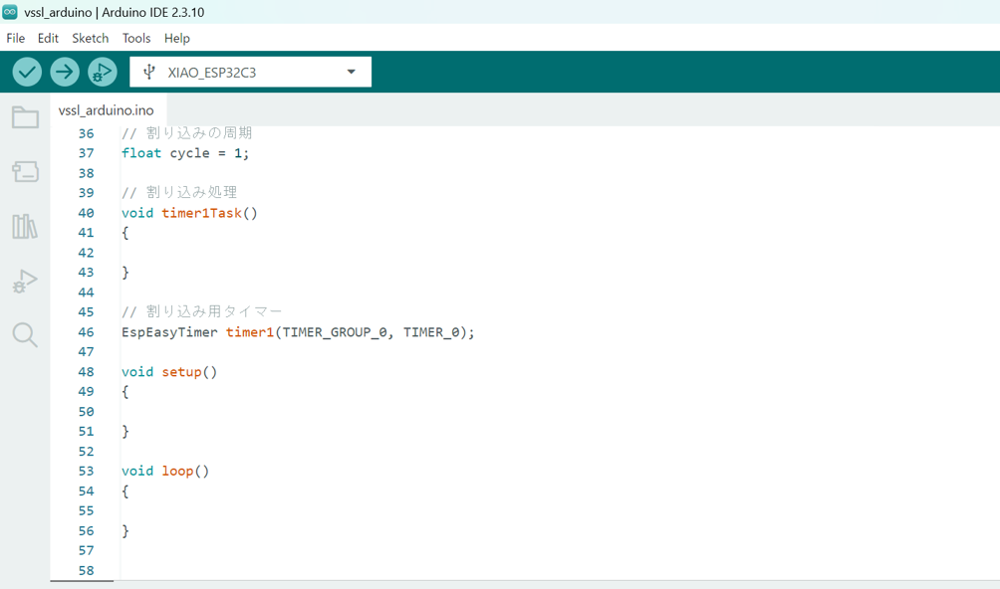

# 音をならす

## 1. 音を鳴らそう

ロボットの回路基板は圧電スピーカーを搭載しています。圧電スピーカーはパルス波などの電圧波形を与えることで，振動子を振動させて音を鳴らすことができるデバイスです。振動数(周波数)を変えると音階が変わります。


setup関数に次の命令を入力します。かっこの中の440の部分を書き換えると，違う周波数の音を鳴らすことができます。

-   プログラム 1　440Hz（ラの音）で鳴らす

```cpp
void setup() {
    speaker.beep_Hz(440);
}
```

## 2. 音階を奏でよう

-   プログラム 2　音階を奏でる

```cpp
void setup() {
    speaker.beep(1); // ドの音を鳴らす
    delay(1000); // 1秒(1000ミリ秒)待つ
    speaker.beep(2); // レの音を鳴らす
    delay(1000);
    speaker.beep(3); // ミの音を鳴らす
    delay(1000);
    speaker.stop(); // 音を止める
}
```

## 3. 曲を演奏しよう

タイマー割り込みを使って曲を演奏するプログラムです。speaker.update()が1msごとに呼ばれます。

-   プログラム 3　曲を演奏するプログラム（一部）
```cpp
// 割り込み処理
void timer1Task()
{
    speaker.update();
}

// 割り込み用タイマー
EspEasyTimer timer1(TIMER_GROUP_0, TIMER_0);

void setup() {
    delay(1000);

    // 割り込み開始
    timer1.begin(timer1Task, cycle);

    // 譜面を設定
    Speaker::tone_type melody[]{
    {1, 500},
    {1, 500},
    {5, 500},
    {5, 500},
    {6, 500},
    {6, 500},
    {5, 1000},
    {4, 500},
    {4, 500},
    {3, 500},
    {3, 500},
    {2, 500},
    {2, 500},
    {1, 1000},
    {Speaker::STOP, 0} // 曲の終わり
    };

    // 曲を演奏
    speaker.set_melody(melody);
}
```
Speaker::STOPの代わりにSpeaker::REPEATを使うと繰り返し演奏することができます。
