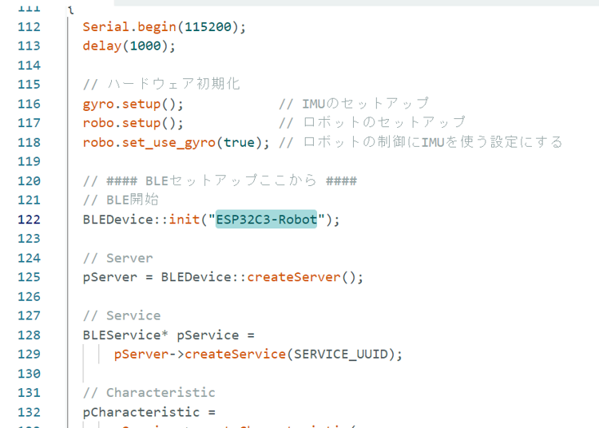
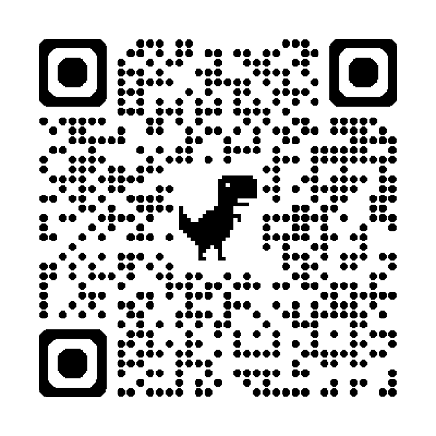
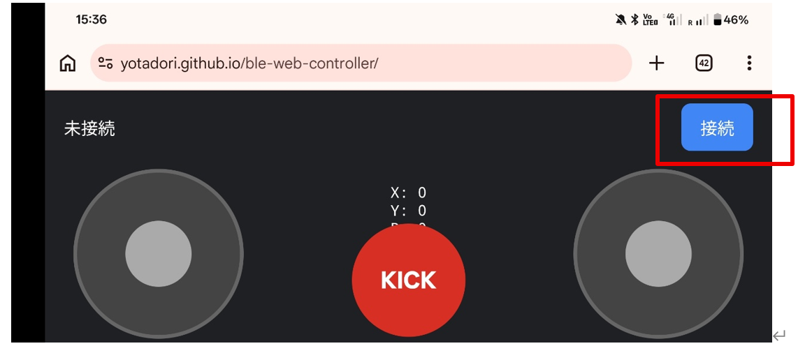
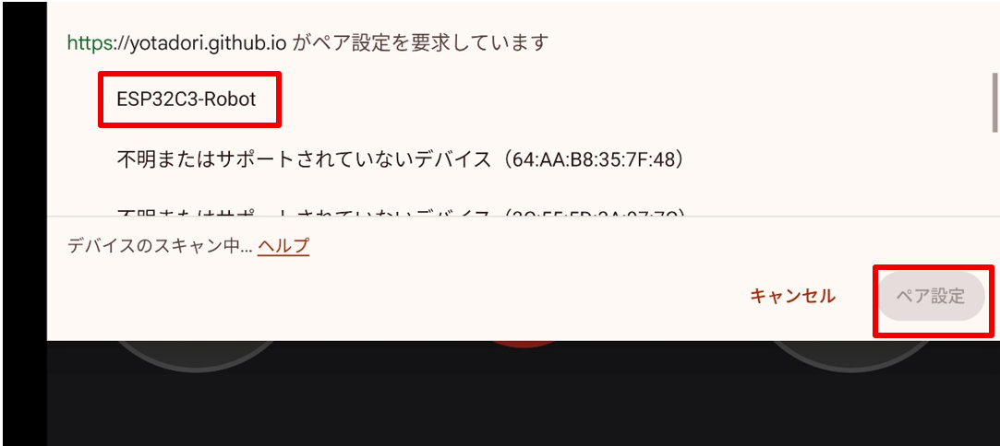
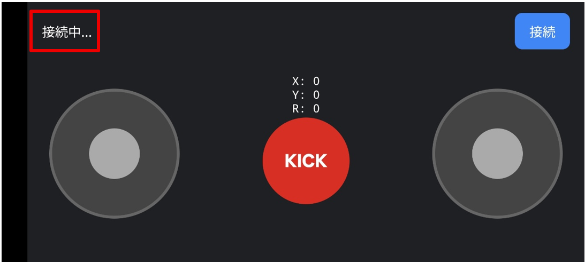
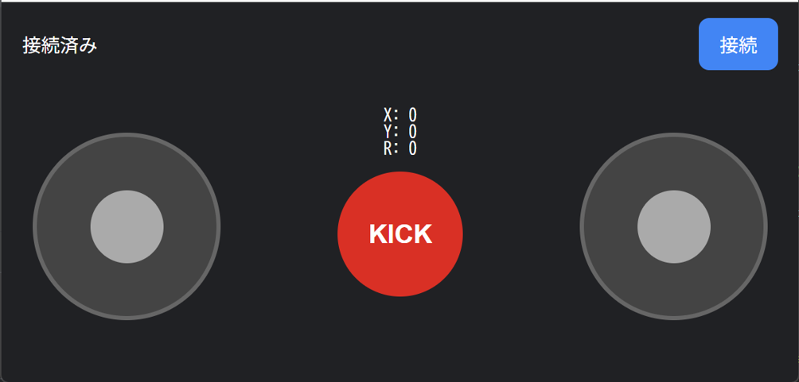

# スマホやパソコンで操作してみよう

スマホやパソコンとBLE（Bluetooth Low
Energy）で接続して、ロボットを操作します。

## 1. リモコン操作用プログラム

1. 下記プログラムをコピーしてください。
<details><summary>リモコン操作用プログラム（全体）</summary>

```cpp
// vssl_arduino.ino

#include "EspEasyTimer.h"
#include "src/Servo/Servo.h"
#include "src/Rot_Servo/Rot_Servo.h"
#include "src/Robot/Robot.h"
#include "src/Speaker/Speaker.h"
#include "src/Gyro/Gyro.h"
#include <BLEDevice.h>
#include <BLEServer.h>
#include <BLEUtils.h>

#define SERVICE_UUID        "74481047-6d8e-45da-8efc-f9f0d5be516c"
#define CHARACTERISTIC_UUID "48f59ea4-7c6a-488c-ad50-aa83aee11092"

// ピン番号
constexpr int SERVO_PIN = D3;
constexpr int ROT_PIN_1 = D1;
constexpr int ROT_PIN_2 = D2;
constexpr int ROT_PIN_3 = D10;
constexpr int SPEAKER_PIN = D0;
constexpr int US_TRIG_PIN = D6;
constexpr int US_ECHO_PIN = D7;

// サーボモーター（キック用モーター）
Servo servo0 = Servo(0, SERVO_PIN, 0);
// 連続回転サーボモーター（ホイールのモーター）
Rot_Servo rot1 = Rot_Servo(1, ROT_PIN_1, 0);
Rot_Servo rot2 = Rot_Servo(2, ROT_PIN_2, 0);
Rot_Servo rot3 = Rot_Servo(3, ROT_PIN_3, 0);

// ジャイロセンサー
Gyro gyro = Gyro();

// ロボット
Robot robo = Robot(rot1, rot2, rot3, servo0, gyro);

// スピーカー
Speaker speaker = Speaker(4, SPEAKER_PIN);

// BLE設定
BLEServer* pServer = nullptr;
BLECharacteristic* pCharacteristic = nullptr;

class MyCallbacks : public BLECharacteristicCallbacks
{
  void onWrite(BLECharacteristic *characteristic)
  {
    std::string value = characteristic->getValue();
    String str = String(value.c_str());

    Serial.print("Received: ");
    Serial.println(str);

    int x;
    int y;
    int r;
    int kick;

    int result = sscanf(
        value.c_str(),
        "%d,%d,%d,%d",
        &x,
        &y,
        &r,
        &kick);

    if (result == 4)
    {
      Serial.print("x = ");
      Serial.println(x);

      Serial.print("y = ");
      Serial.println(y);

      Serial.print("r = ");
      Serial.println(r);

      Serial.print("kick = ");
      Serial.println(kick);

      // ロボットの速度を設定
      xyz_t vel = {0.3 * y, -0.3 * x, -0.005 * r};
      robo.set_target_vel(vel);
      if (kick == 1) {
        robo.kick();
      }
    }
    else
    {
      Serial.println("Invalid data");
    }
  }
};

// 割り込みの周期
float cycle = 1;

// 割り込み処理
void timer1Task()
{
  speaker.update();
  gyro.update();
  robo.execute(cycle);
}

// 割り込み用タイマー
EspEasyTimer timer1(TIMER_GROUP_0, TIMER_0);

void setup()
{
  Serial.begin(115200);
  delay(1000);

  // ハードウェア初期化
  gyro.setup();            // IMUのセットアップ
  robo.setup();            // ロボットのセットアップ
  robo.set_use_gyro(true); // ロボットの制御にIMUを使う設定にする

  // #### BLEセットアップここから ####
  // BLE開始
  BLEDevice::init("ESP32C3-Robot");

  // Server
  pServer = BLEDevice::createServer();

  // Service
  BLEService* pService =
      pServer->createService(SERVICE_UUID);

  // Characteristic
  pCharacteristic =
      pService->createCharacteristic(
        CHARACTERISTIC_UUID,
        BLECharacteristic::PROPERTY_WRITE |
        BLECharacteristic::PROPERTY_WRITE_NR
      );

  pCharacteristic->setCallbacks(
      new MyCallbacks()
  );

  // Service開始
  pService->start();

  // Advertising
  BLEAdvertising* pAdvertising =
      BLEDevice::getAdvertising();

  pAdvertising->addServiceUUID(
      SERVICE_UUID
  );

  BLEDevice::startAdvertising();

  Serial.println("BLE advertising started");
  Serial.println("Device name: ESP32C3-Robot");

  // #### BLEセットアップここまで ####

  // タイマー開始
  timer1.begin(timer1Task, cycle); // 割り込み開始

  // 音を鳴らす
  static Speaker::tone_type start_melody[]{{5, 200}, {4, 200}, {3, 400}, {5, 200}, {8, 200}, {7, 400}, {5, 200}, {9, 200}, {8, 400}, {10, 200}, {Speaker::STOP, 0}};
  speaker.set_melody(start_melody);
}

void loop()
{
  delay(1000);
}
```
</details>

2. デバイス名の変更
vssl_arduino.ino内のBLEDevice::init("")の引数を修正します。近くの人と同じにならないようにします。デフォルトでは"ESP32C3-Robot"となっています。



修正したら、この新しいvssl_arduino.inoを、ロボットに書き込みます。

## 2. コントローラーの接続

スマホ(Android)の場合を説明します。

1.  コントローラー用Webアプリを開く

    以下のURLを、Chromeブラウザアプリで開いてください：

    https://yotadori.github.io/ble-web-controller/

    

2.  　ロボットを起動する

3.  　画面上の「接続」ボタンを押す
    

4.  デバイスを選択

    

5.  画面左上の表示が、「接続中」から「接続済み」に代わると、接続成功。

    

> WindowsのChromeブラウザの場合も、同様の手順で接続できます。
>
> iOSの場合は、SafariはBLEの接続に対応していないので、別のブラウザアプリを使う必要があります。bluefyというアプリが使えるようです：
>
> <https://apps.apple.com/jp/app/bluefy-web-ble-browser/id1492822055>

## 3. 操作方法



左側のパッドでロボットを前後左右に動かせます。

右側のパッドでロボットの回転を操作できます。

真ん中のKICKボタンでキックができます。

パソコンの場合は、WASDキーで移動、矢印キーで回転、スペースキーでキックができます。

