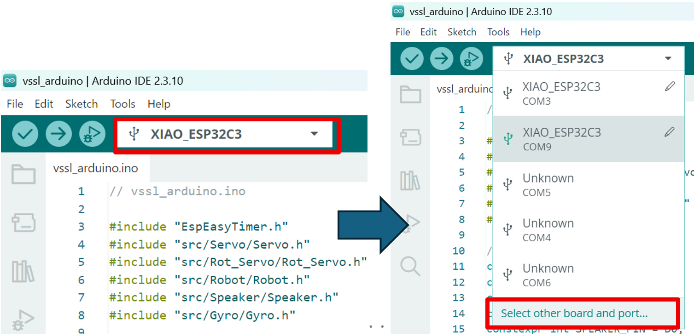
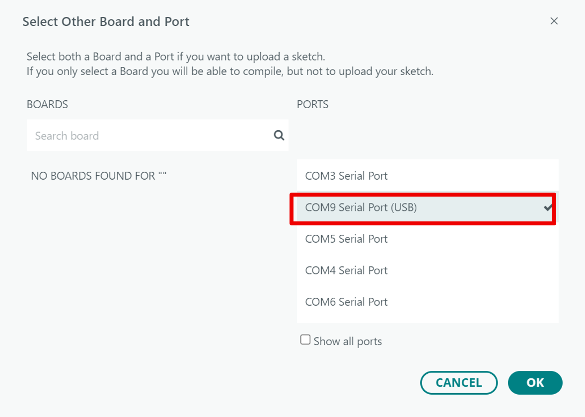
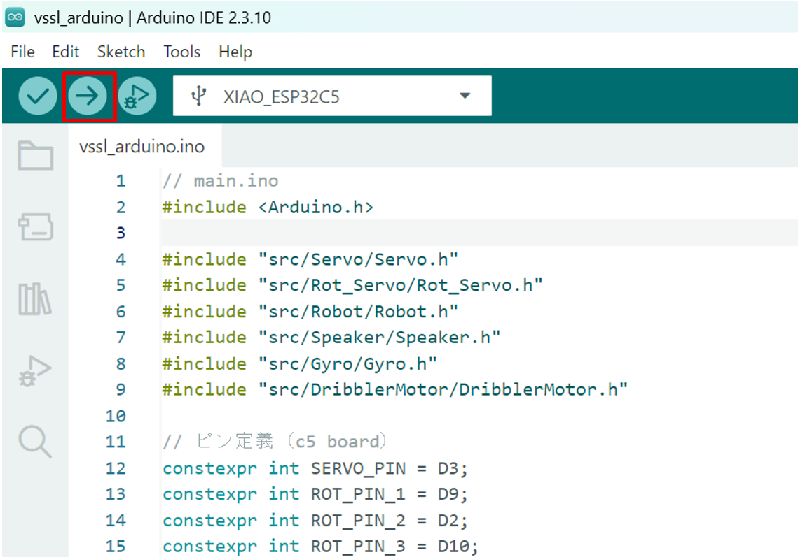

# プログラムの書き込み・実行方法

## 1. マイコンボードとPCを接続する

マイコンボードとPCをUSBケーブルで接続します。USBケーブルには充電専用の通信できないものがあるので、気を付けましょう。

## 2. ポートを選択する

ボード名が表示されている四角をクリックし、「Select other board and
port...」クリックします。

　ロボットのマイコンが接続されているPORTを選択し、「OK」をクリックします：

## 3. マイコンへの書き込み・実行

画面左上のアップロードボタン（右矢印）をクリックします

