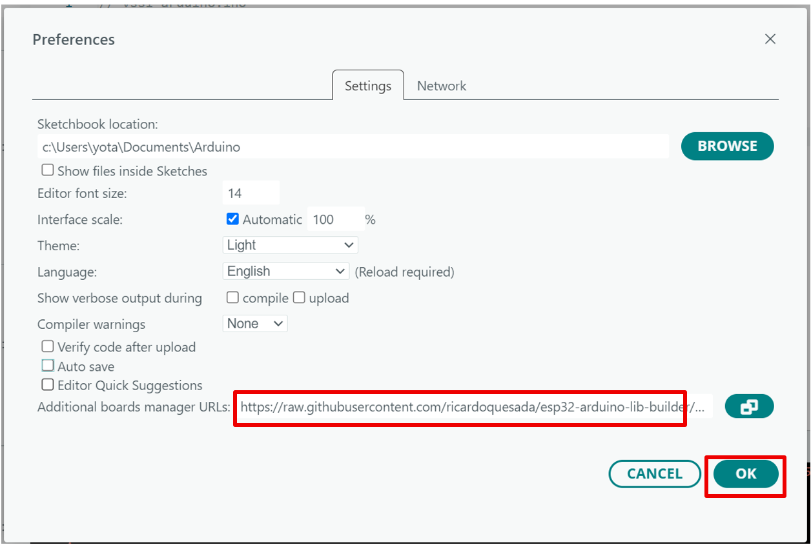
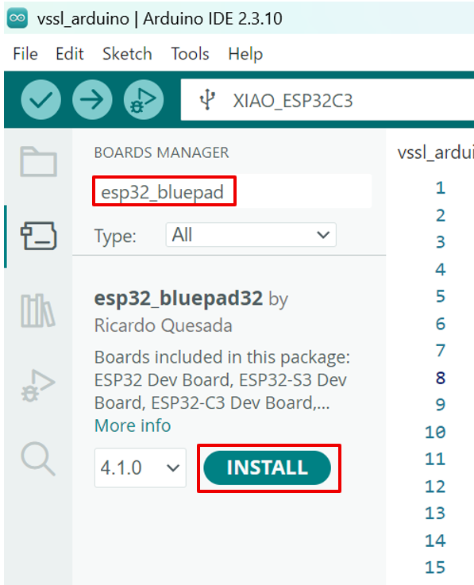
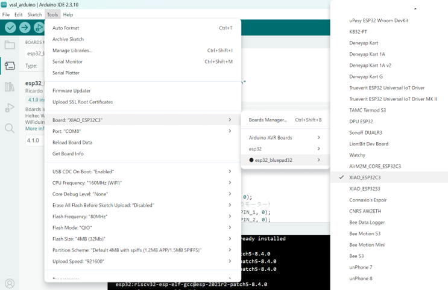
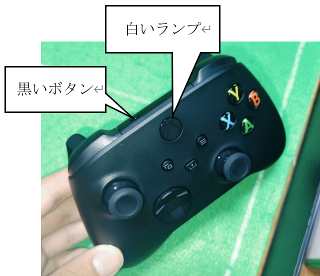

# Xboxリモートコントローラーで操作してみよう

XBOXリモートコントローラーまたはそれに類するBLE対応のゲームパッドでロボットを操作できます。

参考：https://bluepad32.readthedocs.io/en/latest/plat_arduino/

## 1. Bluepad32のセットアップ

①　File \> Preferencesに移動し、「Additional boards manager
URLs」に以下のURLを入力します：

> https://raw.githubusercontent.com/ricardoquesada/esp32-arduino-lib-builder/master/bluepad32_files/package_esp32_bluepad32_index.json



②　OKを押します。

③　Tools \> Board \> Boards Manager...
に移動し、検索ボックスにキーワード「esp32_bluepad」を入力し、esp32_bluepadの最新バージョンを選択し、インストールします



## 2. ボードを選択する

Tools \> Board \> esp32_bluepad32
に移動し、「XIAO_ESP32C3」を選択します。

> ※esp32ではなく、**esp32_bluepad**から選択すること

> ※別のプログラムを試すときは、esp32から選択しなおすこと



## 3. リモコン操作用プログラム

下記プログラムを書き込んでください。

<details><summary>リモコン操作用プログラム（全体）</summary>

```cpp
// vssl_arduino.ino

#include "EspEasyTimer.h"
#include "src/Servo/Servo.h"
#include "src/Rot_Servo/Rot_Servo.h"
#include "src/Robot/Robot.h"
#include "src/Speaker/Speaker.h"
#include "src/Gyro/Gyro.h"
#include <Bluepad32.h>

// ピン番号
constexpr int SERVO_PIN = D3;
constexpr int ROT_PIN_1 = D1;
constexpr int ROT_PIN_2 = D2;
constexpr int ROT_PIN_3 = D10;
constexpr int SPEAKER_PIN = D0;
constexpr int US_TRIG_PIN = D6;
constexpr int US_ECHO_PIN = D7;

// サーボモーター（キック用モーター）
Servo servo0 = Servo(0, SERVO_PIN, 0);
// 連続回転サーボモーター（ホイールのモーター）
Rot_Servo rot1 = Rot_Servo(1, ROT_PIN_1, 0);
Rot_Servo rot2 = Rot_Servo(2, ROT_PIN_2, 0);
Rot_Servo rot3 = Rot_Servo(3, ROT_PIN_3, 0);

// ジャイロセンサー
Gyro gyro = Gyro();

// ロボット
Robot robo = Robot(rot1, rot2, rot3, servo0, gyro);

// スピーカー
Speaker speaker = Speaker(4, SPEAKER_PIN);

// Xboxコントローラー用
int deadzone = 30;            // スティックのデッドゾーン
float scale = 100.0f / 512.0f; // -511..512 -> -100..100 のスケール
// 使うコントローラ（最初に見つかったものを使う）
ControllerPtr myController = nullptr;
bool isConnected = false; // 接続されているか
// キックフラグ
bool kick_flag = false;

// Bluepad32コールバック（接続）
static void onConnectedController(ControllerPtr ctl)
{
  if (myController != nullptr)
  {
    Serial.println("CALLBACK: Controller already connected. Ignoring.");
    return;
  }

  ControllerProperties properties = ctl->getProperties();

  Serial.printf(
      "Controller model: %s, VID=0x%04x, PID=0x%04x\n",
      ctl->getModelName().c_str(),
      properties.vendor_id,
      properties.product_id);

  myController = ctl;
  isConnected = true;
  Serial.println("CALLBACK: First controller connected.");

  // これ以降、新しいBluetooth接続を受け付けない
  BP32.enableNewBluetoothConnections(false);

  // 音を鳴らす
  static Speaker::tone_type connected_melody[]{{1, 100}, {1, 100}, {5, 100}, {Speaker::STOP, 0}};
  speaker.set_melody(connected_melody);
}

// Bluepad32コールバック（切断）
static void onDisconnectedController(ControllerPtr ctl)
{
  if (myController == ctl)
  {
    Serial.println("Controller disconnected.");
    myController = nullptr;
    isConnected = false;

    // 再び接続を受け付ける
    BP32.enableNewBluetoothConnections(true);

    // 音を鳴らす
    static Speaker::tone_type disconnected_melody[]{{5, 100}, {1, 100}, {1, 100}, {Speaker::STOP, 0}};
    speaker.set_melody(disconnected_melody);
  }
}

// コントローラの入力をロボット用データに変換して更新
void processController(ControllerPtr ctl)
{
  if (!ctl || !(ctl->isConnected() && ctl->hasData() && ctl->isGamepad()))
  {
    robo.set_target_vel({0, 0, 0});
    return;
  }

  // デッドゾーン適用ラムダ
  auto applyDeadzone = [&](int v) -> int
  {
    if (abs(v) < deadzone)
      return 0;
    return v;
  };

  // 左スティック = 移動
  int lx = applyDeadzone(ctl->axisX()); // -511..512
  int ly = applyDeadzone(ctl->axisY()); // -511..512

  // 右スティック X = 回転
  int rx = applyDeadzone(ctl->axisRX());

  // スケーリング（-511..512 -> -100..100）
  xyz_t vel;
  vel.x = -ly * scale * 3.0;
  vel.y = -lx * scale * 3.0; // Y 軸反転（必要に応じて変更）
  vel.z = -rx * scale / 30.0;
  robo.set_target_vel(vel);

  bool last_kick_flag = kick_flag;
  // RB RT LB LT ボタンでキック
  kick_flag = ctl->r1() || ctl->r2() || ctl->l1() || ctl->l2();
  if (kick_flag)
  {
    robo.kick();
  }

  if (kick_flag && !last_kick_flag)
  {
    // コントローラーのバイブレーション
    ctl->playDualRumble(0 /* delayedStartMs */, 250 /* durationMs */, 0x80 /* weakMagnitude */, 0x40 /* strongMagnitude */);
  }
  // デバッグ出力（必要なら有効）
  // Serial.printf("vel: %.1f, %.1f, %.1f, kick=%d, dribble=%d\n", vel_.x, vel_.y, vel_.z, kick_flag_, dribble_pow_);
}

// 割り込みの周期
float cycle = 1;

// 割り込み処理
void timer1Task()
{
  speaker.update();
  gyro.update();
  if (isConnected) {
    // 接続されているならロボットを動かす
    robo.execute(cycle);
  } else {
    robo.stop();
  }
}

// 割り込み用タイマー
EspEasyTimer timer1(TIMER_GROUP_0, TIMER_0);

void setup()
{
  delay(1000);

  // ハードウェア初期化
  gyro.setup();            // IMUのセットアップ
  robo.setup();            // ロボットのセットアップ
  robo.set_use_gyro(true); // ロボットの制御にIMUを使う設定にする

  // #### BLUEPAD32のセットアップここから ####
  Serial.printf("XboxControllerReceiver: firmware=%s\n", BP32.firmwareVersion());
  const uint8_t *addr = BP32.localBdAddress();
  Serial.printf("BD Addr: %02X:%02X:%02X:%02X:%02X:%02X\n", addr[0], addr[1], addr[2], addr[3], addr[4], addr[5]);

  // Bluepad32 のセットアップ（コールバックを渡す）
  BP32.setup(&onConnectedController, &onDisconnectedController);

  // 必要ならペアリング情報を消す（コメントアウト可）
  // BP32.forgetBluetoothKeys();

  // 仮想マウスを無効（必要なら true に）
  BP32.enableVirtualDevice(false);

  Serial.println("XboxControllerReceiver: setup complete");
  // #### BLUEPAD32のセットアップここまで ####

  // タイマー開始
  timer1.begin(timer1Task, cycle); // 割り込み開始

  // 音を鳴らす
  static Speaker::tone_type start_melody[]{{5, 200}, {4, 200}, {3, 400}, {5, 200}, {8, 200}, {7, 400}, {5, 200}, {9, 200}, {8, 400}, {10, 200}, {Speaker::STOP, 0}};
  speaker.set_melody(start_melody);
}

void loop()
{

  bool dataUpdated = BP32.update();
  if (dataUpdated)
  {
    processController(myController);
  }

  delay(10);
}

```
</details>

## 4. 接続方法

①　ロボットの電源を入れる。

②　コントローラー上部の黒いボタンを、白いランプが点滅するまで押す。

コントローラーの白いランプが点灯に変われば接続成功。



## 5. 操作方法

左のスティックで移動。

右のスティックで回転。

トリガボタンでキック。
